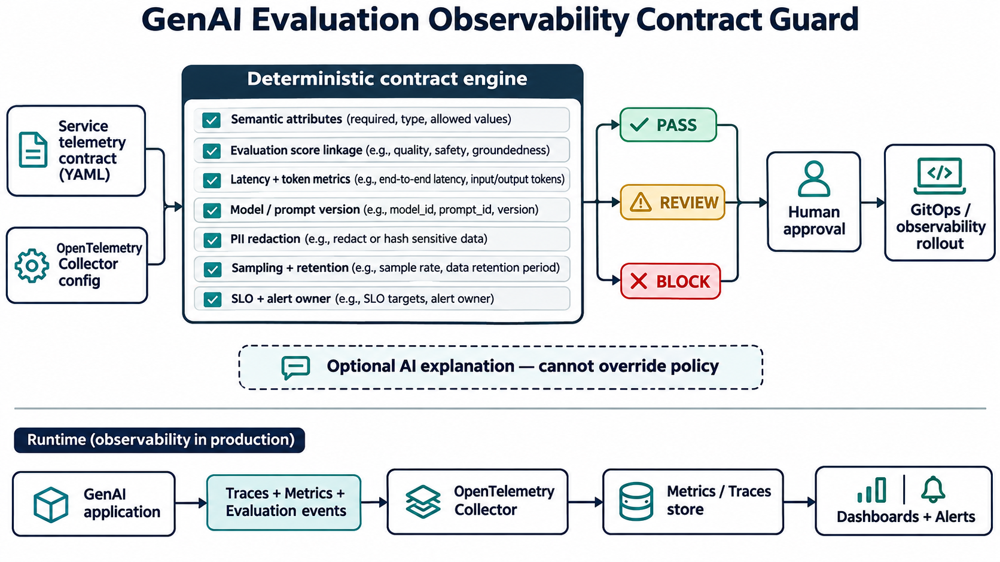

# GenAI Evaluation Observability Contract Guard

A deterministic pre-merge gate that makes GenAI quality, reliability, cost, and privacy signals part of one production observability contract.



## Production problem

Teams often monitor latency and errors while evaluation scores live in a separate system without model, prompt, or trace linkage. That makes incidents hard to diagnose: a release can meet infrastructure SLOs while response quality or groundedness degrades. Capturing raw prompts to compensate can introduce privacy risk.

This guard validates the contract before observability configuration is rolled out. It checks OpenTelemetry-aligned attributes, evaluation coverage and linkage, operational metrics, model and prompt versions, content-capture defaults, redaction, sampling, retention, SLOs, ownership, baselines, and rollback response.

## Why now

Current ML-platform and AI-infrastructure roles repeatedly combine Kubernetes/cloud platforms, evaluation pipelines, observability, reproducibility, and production reliability. OpenTelemetry defines shared GenAI attributes and evaluation fields, while managed model-monitoring guidance treats drift and skew as ongoing operational signals.

## Quick start

```bash
python -m venv .venv
source .venv/bin/activate
pip install -e . pytest
pytest -q
genai-observability-guard samples/compliant-contract.yaml
```

PASS exits `0`; REVIEW and BLOCK exit `2` for CI enforcement.

## Deterministic checks

- required service and `gen_ai.*` semantic attributes
- latency, time-to-first-token, token, and error metrics
- quality, safety, and groundedness evaluations
- trace, model-version, and prompt-version linkage
- prompt/response content capture disabled by default
- PII and credential redaction
- bounded sampling and retention
- availability, latency, and quality SLOs
- alert owner, runbook, versioned baseline, and rollback trigger

## Measurable outcomes

Track contract coverage, unsafe releases blocked, mean time to correlate quality regressions with a release, evaluation-event completeness, raw-content capture rate, false positives, alert ownership coverage, and rollback decision time. Suggested targets are 100% contract coverage, zero unapproved content capture, and a 50% reduction in correlation time during AI incidents.

## Security, privacy, and failure modes

The checker is offline, reads no secrets, and makes no cloud or observability changes. AI may produce a human-readable explanation but cannot change the decision. Static configuration cannot prove runtime telemetry delivery, evaluator accuracy, or rollback safety; validate these with synthetic requests, collector integration tests, and controlled quality-regression exercises.

## Interview positioning

Use this project to explain why AI reliability needs both conventional SRE telemetry and model-quality signals, how you standardize cross-team contracts, why privacy defaults are fail-closed, how you test policy, and where human approval remains necessary.

See [research](docs/research.md) and [deployment guidance](docs/deployment.md).
