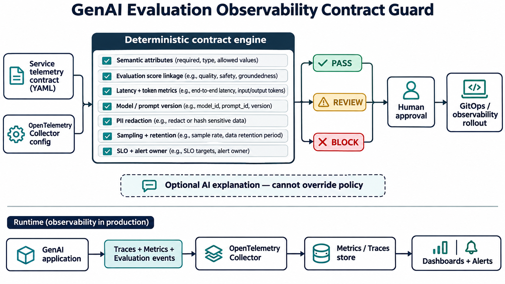

# Connecting GenAI Evaluations to Production Observability

Traditional SRE dashboards can say an AI service is healthy while response quality, groundedness, or safety has degraded. The underlying problem is often fragmentation: infrastructure telemetry, model evaluations, versions, and privacy controls are managed as separate concerns.

## Why this matters now

Current ML-platform roles emphasize evaluation systems, observability, reproducibility, Kubernetes, and production reliability together. OpenTelemetry now supplies shared GenAI attributes, including evaluation fields, while cloud model-monitoring guidance treats drift as an operational signal rather than a one-time validation step.

## The implementation

GenAI Evaluation Observability Contract Guard reads a service contract and emits explainable PASS, REVIEW, or BLOCK findings. It requires service and GenAI semantic attributes, operational metrics, quality/safety/groundedness signals, trace and version linkage, privacy-safe content defaults, redaction, bounded sampling and retention, SLOs, ownership, a versioned baseline, and a rollback trigger.

The enforcement path is deterministic and offline. An AI assistant can summarize evidence, but it cannot modify policy or approve a rollout.

## Tests and deployment

Fourteen tests cover the compliant contract plus missing attributes, metrics, evaluations, linkage, redaction, SLOs, baseline, ownership, retention, sampling, and rollback. GitHub Actions runs the suite and evaluates the sample contract.

Deploy it first in report-only pull-request checks. Measure false positives, migrate contracts, then enforce blocking rules. Runtime validation still matters: send synthetic requests, verify collector delivery and version linkage, seed synthetic PII to test redaction, and run controlled quality-regression exercises.

## Outcomes and trade-offs

Measure contract coverage, evaluation-event completeness, unsafe releases blocked, raw-content capture, correlation time, false positives, ownership coverage, and rollback decision time. Stronger telemetry increases storage and operational cost, while aggressive sampling can hide rare quality failures; retention and sampling therefore need deliberate service tiers.

For interviews, this project demonstrates OpenTelemetry, SRE observability design, AI evaluation operations, privacy-by-default policy, CI enforcement, testable automation, and the judgment to keep human approval in consequential changes.

Repository: https://github.com/ohjeffkuston/genai-observability-contract-guard
